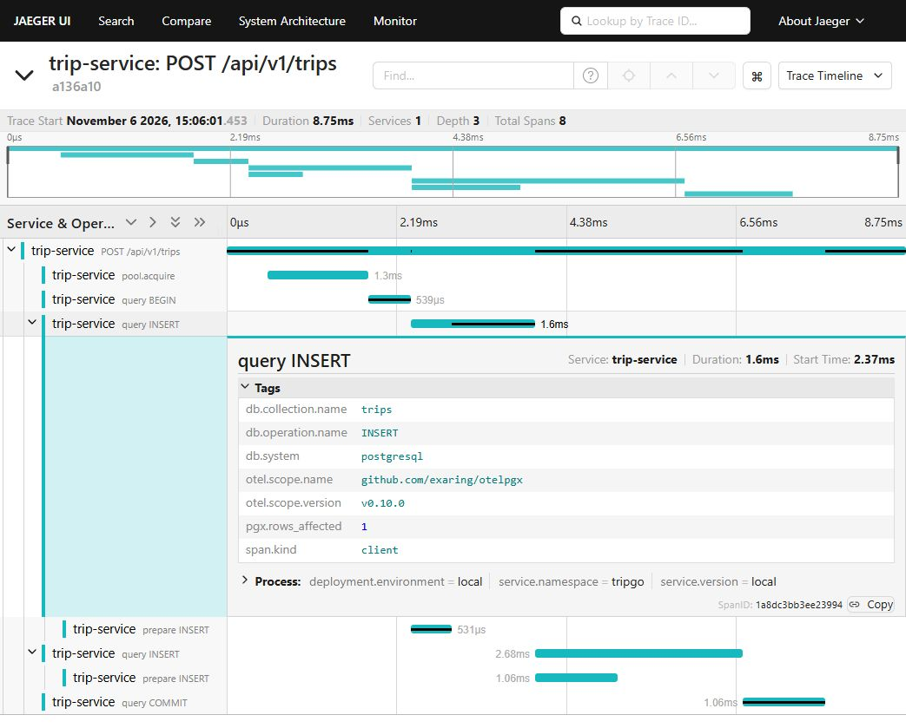
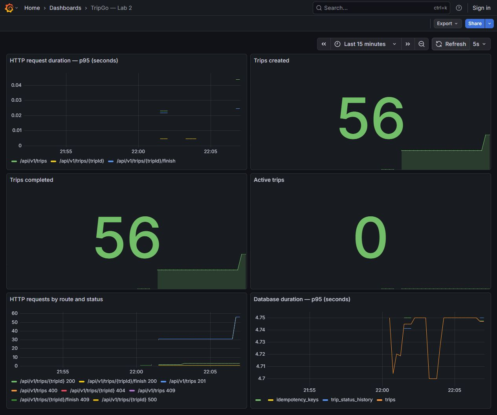

# TripGo — лабораторная работа 2

Сервис создания, получения и завершения поездок. Выполнена обязательная часть
ЛР2: архитектура, тесты, линтер, структурные логи, метрики и трейсы. Мутационное
тестирование (задание со звёздочкой ЛР2) не добавлялось. Контракты, миграции и
набор HTTP-ручек ЛР1 сохранены, включая уже существующую идемпотентность.

## Требования и запуск

Нужны Go 1.26+, make, Docker, golangci-lint v2.15.0. Для `-race` нужен
C-компилятор; на Windows удобно выполнять проверки в Linux/WSL или Go-контейнере.
Для штатного окружения курса установите [tripgoctl](https://github.com/course-go-autumn-2026/course-infra).

```sh
tripgoctl cluster start
tripgoctl environment start
tripgoctl connect
make migrate
make run
```

`environment.toml` скопирован из условий ЛР2: PostgreSQL и observability.
Адреса БД и коллектора, ссылки Jaeger/Grafana/Prometheus берите из `.env` и
вывода `connect`. Makefile сначала загружает `.env.example`, затем `.env`.
Локальные `.env`, `.tripgo/`, инструменты и кеш `.tools/` игнорируются git.

Если tripgoctl недоступен, есть локальный вариант с тем же OTLP-потоком:

```sh
docker compose -f deploy/docker-compose.yaml up -d postgres
docker compose -f deploy/docker-compose.observability.yaml up -d
make migrate
make run
```

Для этого варианта ссылки: [Jaeger](http://127.0.0.1:16686),
[Grafana](http://127.0.0.1:3000/d/tripgo-lab2), [Prometheus](http://127.0.0.1:9090).
При занятых портах измените Compose-конфигурацию и соответствующие env.
Например, `make run HTTP_ADDR=127.0.0.1:18080`. Grafana доступна анонимно только
на loopback; автоматически подключены datasource и дашборд ЛР2.
`make compose-up` также запускает образ сервиса и миграции из ЛР1. Для Docker-целей адрес коллектора на localhost переводится в host.docker.internal; в Compose его можно переопределить через COMPOSE_OTLP_ENDPOINT.

## Архитектура

```text
main → container (единственная точка сборки)
          ├─ HTTP → usecase → domain
          ├─ repository → domain/model
          └─ infra: PostgreSQL, transactions, OpenTelemetry, slog
```

- `cmd/trip-service`: конфигурация, сигналы, вызов контейнера и запуск.
- `internal/container`: создаёт пул, репозитории, SDK, usecase, хендлеры и связывает их вручную.
- `internal/domain/trip`: модель, `Finish`, валидация с полем и причиной, доменные ошибки; без HTTP, SQL и OTel.
- `internal/model`: имена доменных значений для обмена между слоями. Алиасы сохраняют одно представление модели и исключают повторную реализацию правил.
- `internal/usecase/trip/{create,get,finish}`: по пакету на действие, узкие неэкспортируемые интерфейсы в собственном `contract.go`.
- `internal/http/trip/{create,get,finish}`: по пакету на ручку; каждый получает интерфейс своего usecase.
- `internal/http/domainerror`: единственный маппер доменных ошибок в `Problem`; внутренние детали остаются в логе запроса.
- `internal/repository/{trip,idempotency}`: параметризованный SQL, преобразование ошибок PostgreSQL в доменные; зависимости БД — интерфейсы потребителей в `contract.go`.
- `internal/infra/postgres/transaction`: транзакция передаётся через контекст. Репозитории выбирают её вместо пула; отмена контекста и паника не мешают rollback.
- `internal/infra/telemetry`: явные SDK providers, экспортёры OTLP, бизнес-метрики, JSON-логгер с корреляцией.
- `internal/worker/keycleanup`: перенесённая очистка ключей ЛР1, с отдельным контекстом жизни приложения.

Интерфейсы объявляет потребитель: ему известен минимальный набор нужных
операций. Репозиторий не диктует usecase широкий общий интерфейс хранения.
Моки `gomock` генерируются рядом в `mocks_test.go`; отдельного пакета mocks нет.
Проверки зависимостей закреплены `depguard`, включая запрет HTTP → infra/repository.

В задании краткий пункт требует сборки «в main», а подробный §4.1 выносит её в
`container`. Использован подробный вариант: `main` вызывает `container.New`.
Отличия имён: сохранены `cmd/trip-service` из ЛР1 и пакет `idempotency` для уже
имеющейся функциональности. Репозиторий поездок разбит на файлы операций,
общего подключения и конвертации. Новых ручек и миграций нет.

Завершение проверяется доменным `Trip.Finish`, затем SQL обновляет только
активную строку. При конкурентном завершении один запрос получает конфликт.
Поездка и история меняются в одной транзакции. Счётчики и бизнес-логи пишутся
после commit; неудачные операции и повтор идемпотентного запроса не учитываются.

Shutdown: HTTP перестаёт принимать запросы и ждёт текущие, затем останавливается
очистка, сбрасывается телеметрия и закрывается БД. Последний сбор gauge использует живой пул. Общий бюджет задаёт
`SHUTDOWN_TIMEOUT`; превышение приводит к ошибке и завершению процесса.

## Проверки

```sh
make generate           # OpenAPI и все gomock-моки
make fmt                # gofumpt + gci
make lint               # полный набор линтеров курса, включая integration
make test               # -race, покрытие всех пакетов и итог domain + usecase
make test-integration   # -race -tags=integration -count=2, реальный PostgreSQL
```

Без `TEST_DATABASE_URL` интеграционные тесты запускают PostgreSQL через
`testcontainers-go`, нужен работающий Docker. Для БД курса (переопределяется БД репозиторных тестов; тест полного жизненного цикла приложения использует отдельный Docker-контейнер):

```sh
make test-integration TEST_DATABASE_URL='postgres://...'
```

У пользователя БД должно быть право создавать схемы. Каждый тест создаёт
уникальную схему, применяет существующие миграции, затем удаляет только свою
схему. Общие таблицы сервиса не очищаются. Есть реальные ошибки CHECK,
проверка отката обеих вставок, завершения, уникальности активного водителя,
rollback при отмене контекста и панике. Тесты проходят два раза подряд.

Unit-тесты покрывают домен, usecase с моками репозитория/TxManager, маппинг
ошибок и httptest для всех ручек. Валидация проверяет пустое тело, неизвестные
поля, null, неверные UUID/координаты/цену, лишний JSON и превышение лимита.
Middleware проверяются на коды, уровни логов, шаблон маршрута, спаны, метрики
активных запросов и восстановление после паники. Логгер проверяется отдельно
на совпадение trace/span ID. Тесты не используют sleep для синхронизации.

Обязательные сценарии: создание; занятый водитель → 409; завершение;
повторное завершение → 409; отсутствующая поездка → 404; невалидный запрос →
400 `invalid_request`; ошибка репозитория → 500 без внутренних деталей;
откат поездки и истории целиком. `artifacts/verification/` содержит результаты
живых HTTP-проверок и корреляцию лога с настоящим трейсом.

## Телеметрия

Порядок middleware: `Recover → Tracing → Logging → Metrics → router`.
Маршрут определяется через зарегистрированные шаблоны chi, включая ошибки
параметров; неизвестные пути имеют фиксированный label `unmatched`.
В `http.route` нет UUID, поэтому число временных рядов ограничено числом ручек.
Входящий `traceparent` обрабатывается W3C TraceContext, у запроса есть server
span с именем `{method} {route}`. Ошибки помечаются `codes.Error` и `error.type`.

DB-инструментирование установлено в конфигурации пула через `otelpgx`.
Адаптер в `infra/postgres` добавляет актуальные имена DB-атрибутов и histogram
в секундах: используемая версия otelpgx экспортирует старые DB-конвенции.
Её старые метрики направлены в noop provider, чтобы не смешивать единицы.
SQL-параметры и тексты запросов в трейсы не пишутся. Репозитории не создают спаны.

| Метрика | Тип | Единица | Атрибуты |
|---|---|---|---|
| `http.server.request.duration` | histogram | s | method, route, status_code с префиксами `http.*` из задания |
| `http.server.active_requests` | up-down counter | request | `http.request.method`, `http.route` |
| `db.client.operation.duration` | histogram | s | `db.operation.name`, `db.collection.name`, `error.type` |
| `tripgo.trips.created` | counter | trip | без бизнес-labels |
| `tripgo.trips.completed` | counter | trip | без бизнес-labels |
| `tripgo.trips.active` | observable gauge | trip | без бизнес-labels; актуальное число из БД |

Gauge включён по обязательному каталогу `observability.md`. В Prometheus точки
заменяются подчёркиваниями; histogram получает `_seconds_bucket/count/sum`,
counter — `_total`. SDK использует явные providers, а бизнес-код — инъекцию
логгера и интерфейса метрик. Глобального логгера и глобального SDK-контейнера нет.

JSON-логи идут в stdout. Каждая запись имеет `time`, `level`, `msg`, `service`,
`trace_id`, `span_id` (вне спана идентификаторы пустые). Один access log пишется
после ответа: Info для 2xx/4xx, Error для 5xx. Бизнес-события пишут usecase.
Recover пишет панику со стеком и возвращает `500 internal_error`.

Экспорт асинхронный: HTTP не ждёт доступности коллектора. В проверке
`collector-offline.json` зафиксирован ответ 200 при остановленном коллекторе.

## Переменные окружения

Все значения приведены в `.env.example`; переменные БД/HTTP и версии сервиса
валидируются при запуске. Настройки стандартного OTel SDK также читаются из env.

| Переменная | Значение примера / назначение |
|---|---|
| `HTTP_ADDR` | `:8080` |
| `HTTP_READ_TIMEOUT`, `HTTP_READ_HEADER_TIMEOUT` | `5s`, `2s` |
| `HTTP_WRITE_TIMEOUT`, `HTTP_IDLE_TIMEOUT` | `10s`, `60s` |
| `LOG_LEVEL` | `info` (`debug`, `info`, `warn`, `error`) |
| `SHUTDOWN_TIMEOUT` | `10s` |
| `DATABASE_URL` | локальный PostgreSQL; в окружении курса — из `.env` |
| `DATABASE_MAX_CONNS`, `DATABASE_MIN_CONNS` | `10`, `2` |
| `DATABASE_MAX_CONN_LIFETIME` | `30m` |
| `DATABASE_CONNECT_TIMEOUT`, `DATABASE_QUERY_TIMEOUT` | `5s`, `3s` |
| `IDEMPOTENCY_KEY_TTL`, `IDEMPOTENCY_CLEANUP_INTERVAL` | сохранены из ЛР1: `24h`, `1h` |
| `SERVICE_VERSION` | `local`; в сборке задайте версию |
| `OTEL_SERVICE_NAME` | `trip-service` |
| `OTEL_RESOURCE_ATTRIBUTES` | `service.namespace=tripgo,deployment.environment=local` |
| `OTEL_EXPORTER_OTLP_ENDPOINT` | полный URL коллектора из `.env` |
| `OTEL_EXPORTER_OTLP_PROTOCOL` | `http/protobuf` либо `grpc` |
| `OTEL_TRACES_SAMPLER` | `parentbased_always_on`; поддержаны стандартные samplers SDK |
| `OTEL_TRACES_SAMPLER_ARG` | для `traceidratio`/`parentbased_traceidratio`: доля от 0 до 1 |
| `OTEL_EXPORTER_OTLP_TIMEOUT` | `1000`, миллисекунды, стандартная настройка SDK |
| `OTEL_METRIC_EXPORT_INTERVAL` | `5000`, миллисекунды, стандартная настройка SDK |
| `COMPOSE_OTLP_ENDPOINT` | адрес коллектора внутри контейнера Compose; по умолчанию `http://host.docker.internal:4318` |
| `TEST_DATABASE_URL` | необязательная отдельная БД интеграционных тестов; иначе testcontainers |

## HTTP и сдача

Сохранены `POST /api/v1/trips`, `GET /api/v1/trips/{tripId}`,
`POST /api/v1/trips/{tripId}/finish`, `/health`, `/ready`.
OpenAPI и SQL-миграции не изменялись.

```sh
curl -i -X POST localhost:8080/api/v1/trips \
  -H 'Content-Type: application/json' \
  -d '{"user_id":"5cb72c04-7650-45c9-a79b-bcdba0631e0c","driver_id":"8860b315-ec86-42eb-a17c-7c163d721ff5","start_point":{"latitude":55,"longitude":37},"end_point":{"latitude":56,"longitude":38},"price":1200}'
```

Ветка сдачи — `homework/02`, целевая ветка PR — `main`. Описание PR —
[artifacts/PR_DESCRIPTION.md](artifacts/PR_DESCRIPTION.md).
Результаты итоговой проверки — [artifacts/VERIFICATION.md](artifacts/VERIFICATION.md).

Трейс по ID из лога, с вложенными DB-спанами:



Метрики HTTP и поездок:



Для двойного прогона unit-тестов: make test TEST_COUNT=2. Диагностика самого OTel SDK перенаправлена в JSON/slog через стандартный error handler SDK; providers и бизнес-зависимости остаются явными.

Повторная сверка каждого пункта задания: [artifacts/RECHECK.md](artifacts/RECHECK.md).
