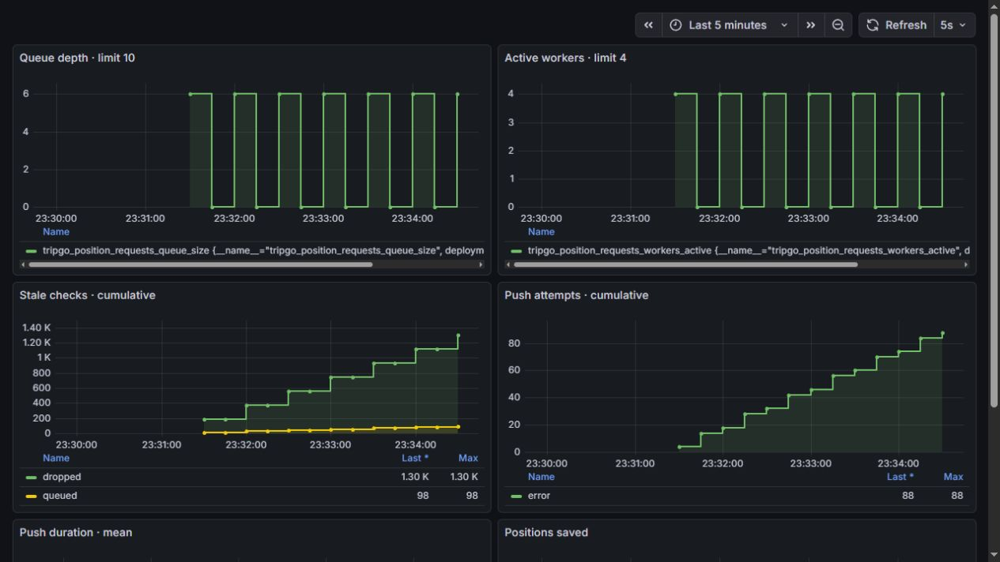

# TripGo — лабораторная работа 3

Сервис создания и завершения поездок, записи координат и получения маршрута.
Выполнена обязательная часть ЛР3: транзакционное сохранение координат, SQL-выборка
устаревших поездок с индексом, сканер, ограниченная FIFO-очередь, worker pool,
HTTP-гейтвей Push Service и телеметрия. Задания со звёздочкой не добавлены:
выборка идёт без LIMIT, очередь — буферизованный канал.

## Запуск

Нужны Go 1.26+, make, Docker, golangci-lint v2.15.0 и
[tripgoctl](https://github.com/course-go-autumn-2026/course-infra).
Для race detector необходим C-компилятор; на Windows проверки можно выполнить
в Linux/WSL или Go-контейнере с доступом к Docker.

```sh
tripgoctl cluster start
tripgoctl environment start
tripgoctl connect
make migrate
make run
```

В корне находится environment.toml именно ЛР3:
PostgreSQL, observability и Push Service. Адреса БД, OTLP и PUSH_HTTP_URL берутся
из .env, созданного tripgoctl. Makefile загружает .env.example, затем .env.
Локальные env, инструменты, кеши и сборки в git не входят.

```sh
make generate
make fmt
make lint
make test TEST_COUNT=2
make test-integration
```

Тесты выполняются с -race. Интеграционные тесты используют настоящий PostgreSQL
через testcontainers; каждому тесту выделяется отдельная схема с собственными
миграциями. TEST_DATABASE_URL позволяет использовать другую тестовую БД, где
разрешено создание схем. Общие таблицы сервиса тесты не очищают.
Goleak проверяет пакеты positions, keycleanup и container.

Для локальной альтернативы PostgreSQL и observability оставлены Compose-файлы
deploy/docker-compose.yaml и deploy/docker-compose.observability.yaml.
Push Service в этом варианте нужно запустить из официального окружения курса.
В Docker-целях loopback-адреса переводятся в host.docker.internal; для Compose
адрес пушей переопределяется COMPOSE_PUSH_HTTP_URL.

## Структура

```text
cmd/trip-service → container
                    ├─ http/position/{save,list} → usecase/position/{save,list} → domain
                    ├─ http/trip/{create,get,finish} → usecase/trip/{create,get,finish}
                    ├─ repository/{trip,position,idempotency} → PostgreSQL
                    ├─ worker/positions → gateway/push → Push Service
                    └─ infra/{postgres,telemetry,system}
```

Интерфейсы объявлены у потребителей в contract.go, моки генерируются рядом.
Зависимости передаются структурами Dependencies; логгер, часы и тикер также
передаются через интерфейсы. Слои проверяются depguard. В домене нет SQL,
HTTP и OpenTelemetry.

## Координаты и маршрут

```sh
curl -i -X POST "http://localhost:8080/api/v1/trips/$TRIP_ID/positions" \
  -H 'Content-Type: application/json' \
  -d '{"coordinates":{"latitude":59.935,"longitude":30.335},"recorded_at":"2026-11-20T12:00:00Z"}'

curl -i "http://localhost:8080/api/v1/trips/$TRIP_ID/positions"
```

POST возвращает 201 и сохранённую точку. Координаты проверяются по диапазону;
recorded_at обязателен, должен быть RFC 3339 и не может опережать часы сервиса
более чем на минуту. Пустое тело, null, пропущенные/неизвестные поля, лишний
JSON и превышение 64 KiB отклоняются. Ошибки: 400 invalid_request,
404 trip_not_found, 409 trip_completed; внутренние ошибки скрыты за 500.

Usecase получает поездку через SELECT FOR UPDATE, проверяет active, вставляет
точку и обновляет last_position_at в одной транзакции TxManager. Блокировка
сериализует сохранение с конкурентным завершением поездки. Watermark обновляется
выражением GREATEST(last_position_at, recorded_at) в SQL: запоздалая точка не
сдвигает время назад. Отмена задачи и tripgo.positions.saved происходят после
успешного commit; при откате не выполняются.

GET отдаёт все точки, включая маршрут завершённой поездки, в порядке
recorded_at, id по возрастанию. Пустой маршрут — positions: [], отсутствующая
поездка — 404. Обычный GET поездки теперь возвращает актуальный last_position_at.

Добавлены только миграции 00004 и 00005; прежние миграции сохранены.
Индекс по существующей таблице trips создаётся CONCURRENTLY отдельной
миграцией без транзакции. Проверены up → down → up.

## Опрос устаревших поездок

```text
time.Ticker → SQL-сканер → buffered channel → фиксированные воркеры → HTTP Push Service
                                ↑
                  сохранённая координата отменяет задачу
```

На каждом тике выполняется один запрос. Он выбирает active-поездки, для которых
COALESCE(last_position_at, started_at) старше текущего времени минус
POSITION_STALE_AFTER. Временное условие и сортировка выполняются в SQL.
Сначала идут самые давно молчащие поездки, при равенстве — по id.
Частичный индекс trips_active_last_position_idx использует то же выражение,
покрывает driver_id и содержит только active-поездки.

Сканер работает последовательно, обходы не накладываются. Offer использует
неблокирующий select: заполненная очередь даёт dropped и Warn. Такая поездка
остаётся устаревшей в БД и будет повторно рассмотрена на следующем тике.
Прогрева состояния после рестарта нет.

Канал имеет ёмкость POSITION_QUEUE_SIZE. Запускается ровно POSITION_WORKERS
долгоживущих воркеров; горутин на поездку или задачу нет. Mutex защищает
pending и число занятых воркеров. Pending удерживает задачу до завершения
обработки, поэтому следующий тик не ставит её повторно.

После commit координаты Cancel удаляет задачу из pending. Элемент физически
остаётся в FIFO до чтения: воркер распознаёт отмену и не вызывает Push Service.
Сравниваются указатели задач, поэтому старый отменённый элемент не удалит новую
задачу той же поездки. Уже начатый внешний запрос мог дойти до устройства —
отозвать отправленную команду нельзя.

Каждая попытка имеет PUSH_REQUEST_TIMEOUT. Отправляется один POST /api/v1/push:
kind=REQUEST_POSITION, recipient_id=driver_id, data.trip_id=id поездки.
Гейтвей использует собственные http.Client и Transport с таймаутами,
закрывает ответы, различает HTTPError со статусом и обёрнутую транспортную
ошибку. Ретраев, rate limiter и переходов по redirect нет.

Время последней отправки не хранится. Пауза повторного опроса — период тикера.
FIFO не обеспечивает общий приоритет между тиками. SQL без LIMIT временно
загружает всю выборку; постоянного кеша поездок нет. Это упрощения обязательной
части ТЗ, их ограничения сохранены явно.

## Конфигурация

Все переменные перечислены в .env.example. Env загружается caarlos0/env/v11,
правила заданы тегами validator/v10. Нулевые/отрицательные размеры и интервалы
отклоняются при старте. PUSH_HTTP_URL обязателен.

| Переменная | Значение примера / назначение |
|---|---|
| POSITION_CHECK_INTERVAL | 30s — период проверки и повторного пуша |
| POSITION_STALE_AFTER | 60s — допустимое отсутствие координат |
| POSITION_WORKERS | 4 — размер пула |
| POSITION_QUEUE_SIZE | 100 — ёмкость FIFO |
| PUSH_HTTP_URL | http://localhost:8090; в окружении курса — адрес из .env |
| PUSH_REQUEST_TIMEOUT | 1s — бюджет одной попытки |
| HTTP_ADDR | :8080 |
| HTTP_READ_TIMEOUT / HTTP_READ_HEADER_TIMEOUT | 5s / 2s |
| HTTP_WRITE_TIMEOUT / HTTP_IDLE_TIMEOUT | 10s / 60s |
| DATABASE_URL | PostgreSQL из .env |
| DATABASE_MAX_CONNS / DATABASE_MIN_CONNS | 10 / 2 |
| DATABASE_MAX_CONN_LIFETIME | 30m |
| DATABASE_CONNECT_TIMEOUT / DATABASE_QUERY_TIMEOUT | 5s / 3s |
| SHUTDOWN_TIMEOUT | 10s — общий бюджет остановки |
| LOG_LEVEL | info; также debug, warn, error |
| IDEMPOTENCY_KEY_TTL / IDEMPOTENCY_CLEANUP_INTERVAL | 24h / 1h; сохранены из ЛР1 |
| SERVICE_VERSION | local |
| OTEL_SERVICE_NAME / OTEL_RESOURCE_ATTRIBUTES | trip-service / атрибуты ресурса |
| OTEL_EXPORTER_OTLP_ENDPOINT | полный URL коллектора из .env |
| OTEL_EXPORTER_OTLP_PROTOCOL | http/protobuf либо grpc |
| OTEL_TRACES_SAMPLER | parentbased_always_on; поддерживаются стандартные samplers SDK |
| OTEL_TRACES_SAMPLER_ARG | доля 0..1 для traceidratio и parentbased_traceidratio |
| OTEL_EXPORTER_OTLP_TIMEOUT / OTEL_METRIC_EXPORT_INTERVAL | 1000 / 5000, миллисекунды |
| COMPOSE_OTLP_ENDPOINT / COMPOSE_PUSH_HTTP_URL | адреса соседей для Compose |
| TEST_DATABASE_URL | необязательная БД репозиторных тестов |

## Остановка

Порядок виден в Container.Run:

1. HTTP Shutdown прекращает приём и ждёт выполняющиеся запросы.
2. Отменяется контекст сканера; его текущий запрос БД прерывается, тикер
   останавливается и единственный producer закрывает канал.
3. Воркеры дорабатывают FIFO с независимым от сканера контекстом.
   Wait получает оставшийся общий SHUTDOWN_TIMEOUT. При исчерпании бюджета
   отменяется текущий I/O, воркеры выходят; приложение логирует ошибку.
4. Закрывается HTTP-клиент; телеметрия сбрасывается при ещё открытой БД,
   затем закрывается пул PostgreSQL.

Уже отменённые задачи не отправляются. Задачи, не успевшие доработать за
бюджет, восстанавливаются из устаревших строк БД после рестарта.

## Телеметрия и проверка

| Метрика | Тип / атрибуты |
|---|---|
| tripgo.positions.saved | counter |
| tripgo.stale_checks | counter, result=queued/duplicate/dropped |
| tripgo.position_requests.queue.size | gauge |
| tripgo.position_requests.workers.active | gauge |
| tripgo.position_requests | counter, result=success/error/cancelled |
| tripgo.position_requests.duration | histogram в секундах, result |

Спан positions.request — новый корень со span link к positions.scan.
Исходящий HTTP-вызов — отдельный client span с W3C traceparent. БД
инструментирована на уровне пула. Бизнес-код не обращается к глобальному SDK.

Тесты проверяют все обязательные сценарии ЛР3, конкурентную работу пула,
отмену и замену задачи, дедупликацию, переполнение, отсутствие наложения тиков,
доработку очереди, принудительную отмену I/O, span link, ошибки HTTP-гейтвея,
SQL-выборку, сортировку, монотонность watermark и реальные rollback.
Время подменяется, синхронизация — каналами и WaitGroup, без time.Sleep.
Моки проверяют входные значения; сценарии usecase задают setup и ожидаемый
результат, общий цикл не содержит ветвлений.

Материалы сдачи для ветки homework/03 и PR в main:

- [Описание PR и проверка 11 пунктов](artifacts/lab3/PR_DESCRIPTION.md).
- [EXPLAIN ANALYZE на 5000 поездках](artifacts/lab3/explain-analyze.txt).
- [Точный SQL из репозитория](artifacts/lab3/explain.sql).
- [Живые HTTP-проверки](artifacts/lab3/http-checks.json).
- Дашборд: deploy/observability/grafana/dashboards/lab3.json.



Предыдущие отчёты ЛР2 сохранены в artifacts/VERIFICATION.md и artifacts/RECHECK.md.
