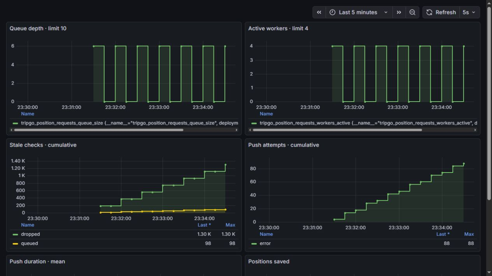

# ЛР3: координаты, очередь и worker pool

Добавлены сохранение координат и получение маршрута поездки. Если активная
поездка долго не присылает координаты, сканер находит её в PostgreSQL и ставит
задачу в ограниченную FIFO-очередь. Фиксированный пул воркеров отправляет
REQUEST_POSITION в Push Service.

Ветка сдачи: homework/03. Целевая ветка: main.
Выполнена обязательная часть; задания со звёздочкой не добавлены.

## Реализация

- POST /api/v1/trips/{tripId}/positions возвращает 201 и сохранённую точку.
  Проверяются структура JSON, обязательные поля, диапазоны координат и
  recorded_at: не более одной минуты в будущем.
- GET /api/v1/trips/{tripId}/positions возвращает все точки в порядке
  recorded_at, id. Пустой маршрут — массив [], завершённая поездка сохраняет
  доступ к маршруту.
- Ошибки возвращаются в Problem: 400 invalid_request, 404 trip_not_found,
  409 trip_completed; внутренние детали не выдаются клиенту.
- Сохранение точки и обновление trips.last_position_at выполняются одной
  транзакцией TxManager. SELECT FOR UPDATE сериализует приём координат с
  завершением поездки. GREATEST в UPDATE не позволяет запоздалой координате
  уменьшить last_position_at.
- После успешного commit отменяется ожидающая задача и увеличивается
  tripgo.positions.saved. При ошибке commit эти действия не выполняются.
- SQL выбирает только active-поездки с устаревшим
  COALESCE(last_position_at, started_at). Условие времени и сортировка
  выполняются в БД, без фильтрации в Go.
- Индекс trips_active_last_position_idx создан отдельной миграцией
  CONCURRENTLY, вне транзакции. Прежние миграции не изменены; up/down/up проверены.
- Сканер, FIFO и воркеры находятся в internal/worker/positions, HTTP-гейтвей —
  в internal/gateway/push. Сканер работает последовательно и не блокируется
  на заполненной очереди. Каждая постановка учитывается как
  queued / duplicate / dropped; dropped сопровождается Warn.
- Буферизованный канал ограничен POSITION_QUEUE_SIZE, воркеров ровно
  POSITION_WORKERS. Mutex защищает pending и состояние пула. Идентичность
  задачи предотвращает ошибку при отмене и повторной постановке той же поездки.
- Тикер и часы передаются через интерфейсы. У гейтвея собственные http.Client
  и Transport с таймаутами; тело ответа закрывается, транспортные ошибки
  отличаются от HTTPError со статусом. Ретраев и переходов по redirect нет.
- Спан обработки задачи является новым корнем и связан со сканом через span
  link. Исходящий HTTP-вызов — отдельный client span с W3C traceparent.
- Остановка: HTTP drain → остановка сканера и закрытие канала → доработка
  очереди в оставшийся SHUTDOWN_TIMEOUT → закрытие клиента, телеметрии и БД.
  При исчерпании бюджета текущий I/O отменяется. Необработанные устаревшие
  поездки снова выбираются после рестарта.

## Конфигурация

| Переменная | Значение по умолчанию / назначение |
|---|---|
| POSITION_CHECK_INTERVAL | 30s |
| POSITION_STALE_AFTER | 60s |
| POSITION_WORKERS | 4 |
| POSITION_QUEUE_SIZE | 100 |
| PUSH_HTTP_URL | обязательный адрес из .env |
| PUSH_REQUEST_TIMEOUT | 1s |
| SHUTDOWN_TIMEOUT | 10s, общий бюджет |

Нулевые и отрицательные размеры/интервалы отклоняются на старте.
Все настройки и команды запуска описаны в корневом README.

## Проверка

Проверено 20 ноября 2026 года, Go 1.26, golangci-lint v2.15.0.
Race detector и интеграционные тесты выполнялись в Linux-контейнере.

| Проверка | Результат |
|---|---|
| make lint | 0 issues |
| make test TEST_COUNT=2 | успешно, -race -count=2 |
| make test-integration | успешно, -race -tags=integration -count=2 |
| goleak.VerifyTestMain | позиции, keycleanup и container — без утечек |
| domain + usecase | покрытие 97,9% |
| сборка сервиса | успешно |
| генерация OpenAPI и gomock | выполнена |
| зависимости домена | без net/http, pgx, chi, OpenTelemetry |

Проверяются все обязательные сценарии:

1. SQL исключает свежие и завершённые поездки, выбирает устаревшие без координат.
2. Повторный тик не дублирует уже ожидающую или обрабатываемую задачу.
3. Координата отменяет ожидающую отправку, в том числе при работающем пуле.
4. Переполнение даёт dropped и не блокирует сканер.
5. N задач обрабатываются фиксированным числом воркеров.
6. Отмена контекста останавливает сканер, очередь дренируется; отдельный тест
   проверяет отмену I/O при исчерпании бюджета.
7. Ошибка Push Service не мешает обработке следующей задачи.
8. Запись координаты и watermark атомарны: реальная ошибка PostgreSQL
   откатывает вставку, отмена задачи и счётчик не выполняются.

Дополнительно проверены сортировка при одинаковых recorded_at, приход старой
координаты после новой, конкурентное завершение поездки, отмена с последующей
заменой задачи, отсутствие наложения тиков, span link, контракт Push Service,
таймауты, закрытие ответов и миграции up/down/up.
В тестах нет time.Sleep; синхронизация выполняется каналами и WaitGroup.
Сценарии usecase содержат setup и полный ожидаемый результат, моки проверяют
аргументы, включая контекст транзакции.

## EXPLAIN ANALYZE

Изолированная БД PostgreSQL 17: 5000 поездок, из них 200 устаревших active и
4800 completed. Перед измерением выполнен ANALYZE. Принудительное отключение
seq scan не использовалось. SQL извлечён из реализации репозитория.

```text
Index Scan using trips_active_last_position_idx on trips
  (cost=0.27..101.51 rows=67 width=40)
  (actual time=0.031..0.064 rows=200 loops=1)
  Index Cond: (COALESCE(last_position_at, started_at) <
               ('2026-11-20 20:33:11.136464+00'::timestamptz - '00:01:00'::interval))
  Buffers: shared hit=8
Planning Time: 1.424 ms
Execution Time: 0.132 ms
```

Полный вывод: [explain-analyze.txt](explain-analyze.txt).
Запрос: [explain.sql](explain.sql).
Подготовка данных: [seed-load.sql](seed-load.sql).

## Метрики под нагрузкой

Использована официальная заглушка Push Service из course-infra,
ревизия 3af8346, без собственной реализации заглушки.

Нагрузочный сценарий: 200 активных поездок без координат, очередь 10,
4 воркера, период проверки 30s. Заглушке задана задержка 5s, таймаут попытки
на проверочном экземпляре — 3s. Основные значения .env.example сохранены:
очередь 100 и таймаут 1s.

На графике видны ограниченная очередь, максимум 4 занятых воркера, рост dropped
и ошибки попыток по таймауту. Значения очереди на скриншоте сняты Prometheus
с интервалом 5s; краткие пики между измерениями могут не отображаться.



После сброса задержки заглушки в 0 пуши снова проходят успешно.
Под нагрузкой выполнено 100 запросов /health: p95 56,48 мс.
Живые HTTP-проверки подтвердили 201/200/400/404/409, сортировку маршрута,
монотонность last_position_at и запрет координат после завершения.

SIGTERM отправлен при 4 занятых воркерах и 6 задачах в очереди:
сервис завершился за 6767,07 мс с exit code 0 в бюджете 10s.
После рестарта опрос возобновился автоматически: зафиксировано 56 успешных
запросов к Push Service без прогрева состояния.

Результаты: [http-checks.json](http-checks.json), [load-checks.json](load-checks.json).
Дашборд: deploy/observability/grafana/dashboards/lab3.json.

## Принятые упрощения обязательной части

- Выборка без LIMIT временно загружает все подходящие строки.
- FIFO сохраняет порядок внутри тика, общего приоритета между тиками нет.
- Время последнего пуша не хранится; интервал повторения задаётся тикером.
- Отменённый элемент физически остаётся в канале до чтения, но внешний вызов
  по нему не выполняется. Уже начатую отправку нельзя отозвать.

Батчевое чтение, приоритетная очередь, ретраи и rate limiter не добавлялись.
